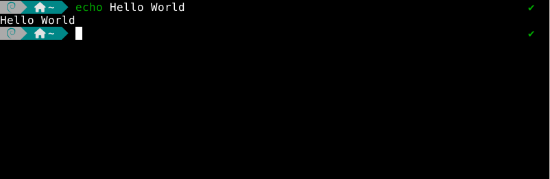

# ZSH-Debian-Config

## ES - Info

Script que automatiza la implementación de la configuración de ZSH de Manjaro para Debian
Advertencia – Testeado en Debian 12/13 con xfce4 y konsole

El paquete incluye:
- Script de activación
- HackNerdFonts
- Configuración y extensiones de ZSH

La configuración ha sido extirpada directamente de Manjaro 26.
(La configuración de ZSH de Manjaro es la MEJOR)

Este es mi primer script que publico, llevo bastante tiempo usándolo en varios equipos y no he tenido ningún problema, si detectas algún error déjamelo por Issue.

## ES - Instalación

git clone [https://github.com/Davd6/ZSH-Debian-Config.git](https://github.com/Davd6/ZSH-Debian-Config.git)
cd ZSH-Debian-Config
chmod +x install.sh
./install.sh

O descarga el .run desde Releases

## EN - Info

Script that automates the deployment of Manjaro's ZSH configuration for Debian
Warning – Tested on Debian 12/13 with xfce4 and konsole

The package includes:
- Activation script
- HackNerdFonts
- ZSH configuration and extensions

The configuration has been taken directly from Manjaro 26.
(Manjaro’s ZSH configuration is the BEST)

This is the first script I’ve published; I’ve been using it on several computers for quite some time and haven’t had any issues. If you find any bugs, please report them as an issue.

## EN - Installation

git clone [https://github.com/Davd6/ZSH-Debian-Config.git](https://github.com/Davd6/ZSH-Debian-Config.git)
cd ZSH-Debian-Config
chmod +x install.sh
./install.sh

Or download the .run file from Releases

The script is in Spanish. First, it will ask if you want to continue (y/n); second, it will ask for the username of the user to whom you want to apply the settings; and finally, it will ask for that user's password.

